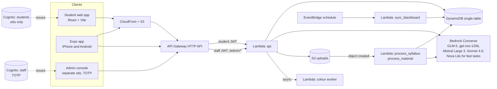

# Semester OS

**Upload your syllabi and get a dedicated AI agent for every class, a calendar that updates itself, and a marketplace that already knows which books you need, at any US college, from the first sign-up.**

**Live demo:** https://dh4zdrl7qb6ai.cloudfront.net (sign in with any .edu email; demo marketplace data is labelled, checkout is simulated)

Track: HackBama_01, Track 1 (College of Engineering): Multi-Campus Marketplace.

> Status note: this README describes the code in this repository. Items marked **in progress** are coded and tested offline but not yet deployed (or not yet exercised on a real device). Nothing is claimed as live unless it has been checked against the real AWS account.

---

## Contents

1. [What it is](#what-it-is)
2. [How it maps to the track rubric](#how-it-maps-to-the-track-rubric)
3. [Architecture](#architecture)
4. [Tech stack](#tech-stack)
5. [Repo layout](#repo-layout)
6. [Prerequisites](#prerequisites)
7. [Setup and deploy from scratch](#setup-and-deploy-from-scratch)
8. [Seed demo data](#seed-demo-data)
9. [Run the web and Expo apps locally](#run-the-web-and-expo-apps-locally)
10. [Tests and red-team checks](#tests-and-red-team-checks)
11. [Demo script](#demo-script)
12. [Security summary](#security-summary)
13. [Honest limitations and roadmap](#honest-limitations-and-roadmap)
14. [Credits, team, license](#credits-team-license)

---

## What it is

Most campus marketplaces ask you to browse. Semester OS is a **need-first marketplace inside a chief-of-staff for college**: your syllabus tells the app what you need, so the marketplace comes to you. The required book for MIS 430 shows up already matched against listings at your school and at other schools; a tutor for the class you are struggling in is one tap away; tickets, supplies and trades live in the same place.

What is in the product:

- **One agent per class, plus a general agent.** Drop a syllabus PDF and a class agent builds itself: deadlines, grading policy, study blocks, required books. Each class agent has its own persistent chat history, visible and editable memory, uploaded materials with retrieval, deadlines and a Blackboard/feed status. The general ("chief of staff") agent handles the day: briefing, plan, cross-class questions. If you ask it about a class, it **hands you to that class agent** with a banner and an Undo, and the app re-themes in the class colour.
- **Auto-campus from a verified `.edu` email.** There is no "request your school" step. A verified `.edu` address (Cognito email code) is the campus verification. The first verified student at a school creates its themed campus automatically: official name from a public registry, colours from a verified table (251 domains) or a colour-finder worker, otherwise a safe generated placeholder that an admin can review. Non-`.edu` emails are rejected with a friendly message (unless an admin has set up a demo account).
- **Marketplace (cross-campus).** Books, supplies, electronics, dorm gear, tickets, tutoring, and trades, with `sell`, `trade`, `free`, `wanted` and `service` kinds. Listings always show their campus. Required-book matches come from your classes. In-app chat per listing (no seller email is ever exposed), report and auto-hide moderation. No payments are handled. Tickets are never transferred through us and are capped at face value by default.
- **Real names and pictures.** Sign-up asks for first and last name (greetings use the first name only; no email prefix is ever shown). Marketplace listings carry pictures (`images: [{url, alt}]`): the demo data uses a set of 30 original SVG illustrations in `web/public/demo/market/`; listings without a picture show a category tile. *Status: **live** (deployed and verified).* Student photo uploads are roadmap.
- **More in the product.** Classes appear as agent cards you can click (Building, Ready or Error), with **Archive and Restore** (Settings). Sign-up asks for first and last name; every user gets one of **12 robot avatars** as a profile picture (default from a hash of their account id, never the email). Each class has a **group chat** (classmates who added it) plus private marketplace **Messages**. The marketplace is split into **For sale | Tickets | Tutoring** with pictures and one "Recommended for you" row from your syllabus. **In-app checkout and Orders are simulated** ("Semester OS Pay (demo)": no card fields, no real money). The helper also supports a **daily automatic re-scan** that adds only new items (needs Chrome running). A "learning system" setting (Blackboard, Canvas or Other) adapts the connect steps.
- **Calendar.** A private subscribe link (`.ics`) puts your deadlines in your phone's calendar.
- **LMS connect (browser helper, one click).** The main Blackboard path is the Semester OS browser helper (`extension/`, Manifest V3, prototype: load unpacked, see [docs/EXTENSION.md](docs/EXTENSION.md)). The student presses **Scan my Blackboard**; the helper reads the course list and due dates while they watch, never touches credentials, and sends them to `POST /courses/import`, which creates a class agent per class with its deadlines. Onboarding (`/onboarding`, "Connect Blackboard") shows the classes as they arrive. *Status: the import route is **live**; the helper itself is installed unpacked (no Chrome Web Store release yet).* A calendar share link remains an "advanced" fallback (dates only), and Canvas is roadmap.
- **Admin console.** A separate staff site with its own Cognito pool and mandatory TOTP: campuses (edit, disable, block a domain, colour review), demo accounts, reports and moderation, and an audit log.
- **Web app and native app.** A React web app and an Expo (React Native) app for iPhone and Android that share one API contract and one brand, each written in its platform's idiom.

---

## How it maps to the track rubric

| Rubric item | What we built | Evidence and honest status |
|---|---|---|
| **Multi-tenant** | One deployment serves every school. Tenants are data, not code. The campus is derived from the verified email, never from a request field. | Tenant records, `DOMAIN#` maps and per-user data keys in the DynamoDB single table; ownership checks in `backend/lib/guard.py` and `db.py`. Tests: `backend/tests/test_auto_campus.py`. |
| **Campus-verified** | `.edu` email plus Cognito's emailed code. A pre-signup Lambda rejects non-`.edu` domains and blocked domains. Staff sign in through a separate pool with TOTP. | `backend/pre_signup.py`, `backend/lib/registry.py`. The any-`.edu` pre-signup rule and lazy campus creation are **in progress** as a live deploy (see [status](#what-is-live-and-what-is-not)). |
| **Cross-campus** | Listings and book matches can be searched across open campuses and are always labelled with the campus name. | `backend/listings_api.py`, `books_api.py`, `lib/market.py`, `lib/matching.py`; tests `test_listings_api.py`, `test_books_api.py`, `test_matching.py`. |
| **Per-school customisation** | Theme colours, timezone, tutoring resources, pickup spots, marketplace categories, ticket price cap and LMS connector status are per campus, editable in the admin console. | `scripts/seed.py` (curated UA, Auburn, Georgia Tech), `backend/data/school_colors.json` (251 verified domains), `admin/`. |
| **Actually works** | Real Cognito, DynamoDB, S3, Lambda, API Gateway and Bedrock behind a live CloudFront site. Core path: sign up, upload a syllabus, class agent builds, tutor chat, calendar link. | Phases 0 to 2 plus the admin site were checked live. The master agent and marketplace routes are coded and tested offline and are **in progress** for the next deploy. See [status](#what-is-live-and-what-is-not). |
| **New-campus deploy** | No code and no manual setup: the first verified `.edu` sign-up creates the campus. An admin can also create or edit a campus in the console. | `AUTO_CAMPUS.md`, `backend/data/us_schools.json` (about 2,250 US `.edu` domains), colour worker in `infra/stack.py`. Live demo of this moment is **in progress** pending the deploy. |
| **Polish** | A design system with per-campus and per-class theming, contrast-audited (552 checks per colour scheme, 0 failures at last audit), loading, empty and error states, a logo set, mobile layouts. | `DESIGN.md`, `DESIGN-MOBILE.md`, `design/logo/`, `web/src/styles/`. The Expo app has **never been run on a physical device** yet. |
| **Innovation** | Need-first marketplace inside a per-class agent system; automatic handoff between agents; auto-campus; a four-model fallback chain on Bedrock. | the internal planning notes, the internal planning notes, `AUTO_CAMPUS.md`. |

### What is live and what is not

The architecture diagram uses one legend everywhere: **green = deployed**, **yellow = coded, not deployed**, **grey dashed = planned**. At the last verification (2026-10-17, 4:16 PM, after the final deploy) the CloudFormation stack `SemesterOS` was `UPDATE_COMPLETE` in us-east-1.

- **Live:** student and admin CloudFront sites, HTTP API (public routes, student-JWT routes, staff-JWT `/admin/*`), the `api`, `process_syllabus` and `pre_signup` Lambdas, DynamoDB with two GSIs, the upload bucket, both Cognito pools, the Bedrock model chain.
- **Newly live (final deploy verified 2026-10-17, 4:16 PM):** the one-click Blackboard import route (`POST /courses/import`), first and last name at sign-up, listing pictures (demo illustrations), 12 robot avatars, archive and restore, the three-section marketplace, in-app checkout and Orders (simulated), the helper's daily re-scan, and Blackboard index answers with "Open in Blackboard" links.
- **Also live (deployed over the day, re-verified 2026-10-17 4:16 PM):** the master agent (briefing, router, handoff), marketplace v2 routes, listing chat, `/public/resolve`, any-`.edu` pre-signup and lazy campus creation, colour worker, materials and memory and history modules, Blackboard feed sync and its EventBridge schedule, KMS key for stored feed URLs, admin reports and colour review UI.

---

## Architecture

Full diagram: [`docs/architecture.drawio`](docs/architecture.drawio) (five pages: system overview, agents, auto-campus and auth, security layers, data model). Walkthrough and status legend: [`docs/ARCHITECTURE.md`](docs/ARCHITECTURE.md).



The same shape as plain text:

```
Student web / Expo app / Admin site
        |  (CloudFront + S3 for the two sites)
        v
API Gateway HTTP API ---- JWT authorizer (student pool)  -> /{proxy+}
        |            \--- JWT authorizer (staff pool)    -> /admin/{proxy+}
        v
Lambda api.py -- DynamoDB (single table) | Bedrock Converse | S3 uploads
        ^                                   ^
S3 events -> process_syllabus, process_material
EventBridge -> sync_blackboard        async -> colour worker
```

Key design rules: the user and campus always come from the verified token; model and user text is untrusted data; model tools only run through one validation gate; the API is non-streaming (chat shows a typing indicator).

---

## Tech stack

| Layer | Technology |
|---|---|
| Web | React 18, Vite 6, TypeScript, React Router, Amplify auth |
| Native app | Expo SDK 57, React Native 0.86, Expo Router, `amazon-cognito-identity-js`, expo-secure-store, expo-calendar, haptics, reanimated |
| Admin console | React + Vite (separate bundle, separate origin) |
| Shared | `shared/` TypeScript types, tokens, typed API wrapper (no React or DOM code) |
| Backend | Python 3.12 AWS Lambda, API Gateway HTTP API, DynamoDB single table, S3, EventBridge, KMS |
| AI | Amazon Bedrock Converse: `zai.glm-5` (main), fallbacks `openai.gpt-oss-120b-1:0`, `mistral.mistral-large-3-675b-instruct`, `us.anthropic.claude-sonnet-4-6`; `amazon.nova-lite-v1:0` for routing and classification. PDFs are text-extracted with `pypdf` first |
| Auth | Amazon Cognito: student pool (email code, `.edu` gate) and separate staff pool (TOTP MFA) |
| Infrastructure as code | AWS CDK (Python) in `infra/` |
| Data | Hipo `university-domains-list` (school registry), curated school colours |

---

## Repo layout

```
semesteros/
  backend/           Lambda handlers (api.py, *_api.py, process_*.py, pre_signup.py, sync_blackboard.py, ...)
    lib/             guard, safe_fetch, limits, redact, tutor, routing, matching, registry, feedsync, ...
    data/            us_schools.json (registry), school_colors.json + school_colors_sources.md
    tests/           offline unit tests (no AWS needed)
    vendor/          pip-vendored libraries for the Lambda zip (generated, git-ignored)
  infra/             CDK app: stack.py (main stack), admin_site.py (staff console construct)
  web/               student web app (Vite + React)
  admin/             admin console (Vite + React)
  mobile/            Expo app
  shared/            TypeScript types, design tokens, typed API client
  scripts/           deploy.py, deploy_admin.py, create_admin_user.py, seed.py,
                     build_school_registry.py, redteam.py, offline and smoke tests
  design/            logo set, agent robots, slide-deck layouts
  docs/              ARCHITECTURE.md, architecture.drawio, DEMO_SCRIPT.md, SLIDES_OUTLINE.md
  *.md               API.md and per-module *_API.md contracts, AUTO_CAMPUS.md, the internal planning notes,
                     the internal planning notes, the internal planning notes, SECURITY.md, ADMIN.md, DESIGN*.md, DECISIONS.md
```

---

## Prerequisites

- An AWS account with permission to create Cognito, Lambda, API Gateway, DynamoDB, S3, CloudFront, EventBridge, KMS and IAM resources, and **Amazon Bedrock model access** enabled in `us-east-1` for the models above.
- AWS CLI v2 configured (`aws configure`) for that account.
- Node.js 20+ and npm.
- Python 3.12+ (the Lambdas run 3.12; newer local Pythons work).
- For the Expo app: the **Expo Go** app from the App Store or Google Play (the store version supports SDK 57).
- Note: a new AWS account's Lambda concurrency limit may be 10. The stack deliberately avoids reserved concurrency (see `DECISIONS.md`). Cognito's default email sender is capped at about 50 emails per day; use SES production access before any public launch.

---

## Setup and deploy from scratch

All commands run from the repository root. Replace placeholders such as `<ACCOUNT_ID>`, `<API_URL>` with your own values. The deploy scripts read and write `cdk-outputs.json` (git-ignored) so you do not copy ids by hand.

### 1. Bootstrap CDK (once per account and region)

```bash
aws sts get-caller-identity            # confirm you are in the right account
npx aws-cdk bootstrap aws://<ACCOUNT_ID>/us-east-1
```

### 2. Deploy the stack and the student web app

```bash
python scripts/deploy.py
```

This one command: creates `infra/.venv` and installs the CDK dependencies, **vendors the Lambda libraries** (see below), runs `cdk deploy`, writes `web/public/config.json` from the stack outputs, runs `npm install` and `npm run build` in `web/`, syncs to the S3 website bucket, and invalidates CloudFront. It prints the site URL at the end (`https://<DISTRIBUTION>.cloudfront.net`).

To rebuild and publish only the web app after a UI change: `python scripts/deploy.py --web-only`.

**Vendoring step (`backend/vendor/`).** CDK bundles `backend/` as-is, so the pure-Python libraries the Lambdas import must sit next to the code. `deploy.py` does this for you with:

```bash
pip install --upgrade -r backend/requirements.txt -t backend/vendor
```

(`requirements.txt` pins `pypdf` and includes `tzdata`.) Run that command yourself first if you want to run the backend tests locally. `backend/vendor/` is git-ignored, so a fresh clone must create it. If a deploy is killed part-way (for example by low memory), re-run the command, because a half-copied `tzdata` breaks timezone tests.

### 3. Pin the admin CSP (optional hardening, once)

After the first deploy, add the API origin to the `context` block of `cdk.json` as `"adminApiOrigin": "<API_URL>"`, then run `python scripts/deploy.py` once more. `deploy_admin.py` warns you if the admin Content-Security-Policy still allows any API Gateway host. Do not commit your own deployment's API URL to a public fork.

### 4. Deploy the admin console

```bash
python scripts/deploy_admin.py
```

Reads the stack outputs, writes `admin/public/config.json`, builds `admin/`, syncs to the admin bucket and invalidates the admin CloudFront distribution. It prints the admin URL.

### 5. Create the first staff admin

```bash
python scripts/create_admin_user.py <ADMIN_EMAIL>
# or, to print a temporary password instead of emailing it:
python scripts/create_admin_user.py <ADMIN_EMAIL> --print-password
```

Run it with your own AWS credentials. It creates the user in the staff pool and adds it to the `admins` group. At first sign-in the admin chooses a new password and scans a QR code with an authenticator app (TOTP). Keep that authenticator entry: there is no email recovery, by design.

### 6. Seed demo data

See below.

---

## Seed demo data

```bash
python scripts/seed.py
```

Idempotent. Reads the table name from `TABLE_NAME` or from `cdk-outputs.json`. It writes the curated example campuses (University of Alabama, Auburn University, Georgia Tech) with real theme colours, timezones, tutoring links and pickup spots, plus demo marketplace listings. **Every demo listing is stored with `demo: true` and labelled "Demo listing" in the UI.** No fake listing is presented as real.

Every other US school appears on demand: the first verified `.edu` sign-up creates it (registry name, verified colour if known, otherwise generated). To refresh the school registry from the public dataset:

```bash
python scripts/build_school_registry.py
```

Demo accounts (for stages where email codes are slow) are created in the admin console's Demo accounts tab. Use `student@example.edu`-style addresses only.

---

## Run the web and Expo apps locally

**Web:**

```bash
cd web && npm install && npm run dev
```

It reads `web/public/config.json` (written by `deploy.py`) to reach your deployed API.

**Admin console:** `cd admin && npm install && npm run dev` (after `deploy_admin.py` has written `admin/public/config.json`).

**Expo app (iPhone or Android):**

```bash
cd mobile
npm install
npx expo start --tunnel
```

Scan the QR code with Expo Go. **Use `--tunnel` on restrictive Wi-Fi** (campus networks such as eduroam block phone-to-laptop connections); the API is public, so the phone only needs internet. A phone hotspot also works. Type-check with `npx tsc --noEmit` and `npx expo-doctor`.

---

## Tests and red-team checks

```bash
# backend unit tests (offline, no AWS needed). 3 PDF tests need pypdf: first run
#   pip install -r backend/requirements.txt -t backend/vendor
# (vendor/ is not committed)
python -I -m unittest discover -s backend/tests

# adversarial harness: a stub "compromised model" attacks the guard, tool gate and SSRF protection
python -I scripts/redteam.py

# optional: sends at most ~20 small requests to Bedrock (reads only, needs AWS credentials)
python -I scripts/redteam.py --live

# admin API tests (offline)
python scripts/test_admin_api.py

# mobile
cd mobile && npx tsc --noEmit && npx expo-doctor
```

Last recorded results (re-run before relying on them): the backend suite and the admin tests were green after the last re-vendoring; the offline red-team run passed all of its checks; the live run with GLM-5 was clean in 13 of 14 attempts, and the one miss would have been rejected by the tool gate (see `SECURITY.md` section 9).

---

## Demo script

The 3 to 4 minute demo flow, fallbacks, and the pre-demo checklist are in [`docs/DEMO_SCRIPT.md`](docs/DEMO_SCRIPT.md). In short:

1. A school email at a never-configured school: the page themes itself (auto-campus).
2. Sign in with a pre-made demo account, land on the themed campus page and Today.
3. Study tab: drop a syllabus PDF, watch the class agent build, open the class.
4. General agent: "what is due in MIS 430 and quiz me" triggers the handoff banner with Undo.
5. Tutor tool chips (study blocks, deadlines), then the calendar subscribe link on a phone.
6. Marketplace: the required book with a listing from another campus.
7. Admin console: the new campus and its colour review, plus the audit log.
8. Architecture slide: green is live.

Steps tagged **[NOT LIVE]** in the script (if any remain) have a fallback; the final deploy made everything in the script live.

---

## Security summary

Defence in layers (details and tests in [`SECURITY.md`](SECURITY.md)):

1. **Prompt injection.** Syllabi, materials, memory and web text are untrusted. They are sanitised (control, zero-width, bidi, look-alike characters) and wrapped with a per-request random nonce plus a rules block.
2. **Tool containment.** Models can only call tools through one gate: per-agent allow-list, strict argument schemas, ownership checks, a per-request budget, no destructive tools (a test fails if one is added). Every side effect becomes a visible action chip with an undo.
3. **Output handling.** Model text is sanitised and rendered as plain text or markdown with HTML and images off; a CSP blocks image exfiltration.
4. **SSRF-safe fetching.** `safe_fetch`: https and port 443 only, no IP literals, every resolved address must be public, connection pinned to the vetted IP, size caps.
5. **Limits.** Per-user and per-IP rate limits, body and token caps, API throttling, and an AI kill switch.
6. **Isolation.** The user comes from the JWT; the data layer forces keys to `USER#{sub}` and hides secrets (calendar token, feed URL) from model-facing tools. Calendar feed tokens are rotatable.
7. **Secrets and logs.** A redaction layer removes tokens, keys, emails and feed URLs from logs; no secrets are stored in the repo; stored feed URLs are encrypted.
8. **Staff access.** Separate Cognito pool, mandatory TOTP, no SMS, issuer and group checks, strict headers, and an append-only audit log written in the same transaction as the change.
9. **Supply chain.** Lockfiles committed; dependency audits recorded in `SECURITY.md`.

Marketplace safety: campus-verified users only, per-user daily caps, report and block, auto-hide at three reports, public pickup spots from campus config, in-app checkout and orders (simulated: no real money moves), tickets capped at face value by default.

---

## Honest limitations and roadmap

**Demo data and not-live items**

- Seeded marketplace listings are **demo data**, flagged `demo: true` and labelled "Demo listing". The seeded campuses (UA, Auburn, Georgia Tech) are curated examples. Real pickup spots and tutoring URLs for them are labelled as examples until confirmed.
- These features are **live** (deployed 2026-10-17, re-verified at 4:16 PM): master agent and handoff, marketplace v2 and listing chat, auto-campus lazy creation and colour worker, materials, memory and history, Blackboard feed sync on a schedule, admin colour review and reports. See [What is live and what is not](#what-is-live-and-what-is-not).
- The **Expo app has not been run on a physical device** yet (it type-checks and bundles; Expo Go on SDK 57 is available in the app stores).
- Verification emails use Cognito's default sender (about 50 per day). Production use needs SES production access. For the demo we use pre-made demo accounts.
- AI chat is **not streamed**; the app shows a typing indicator. Bedrock throughput and Lambda concurrency are limited on this account, so a retry or the model fallback chain may add latency.
- New campuses with unknown colours get a generated placeholder until the colour finder or an admin sets the real one. School logos are **not** used (trademarks); the campus badge is the name plus a colour monogram.
- Only US `.edu` schools are supported. Other countries are a registry extension away.

**Integration notes**

- **Blackboard:** UA uses Blackboard Ultra. Official REST access for apps needs an institution administrator to register an integration, so we use the student's own **Share Calendar** link (dates and events only; course identifiers inside event text make matching reliable). The calendar feed does not say which class a deadline belongs to, so the main path is now the browser helper (below); the share link is the advanced fallback. Announcements and files would need a browser extension or email forwarding.
- **Canvas:** planned through the official API with a student-created personal access token (schools may disable these). Not built as a live feature.
- **LMS scan and browser extension:** a student-initiated, read-only Blackboard scan is built as a **prototype** (`extension/`, load unpacked; no Chrome Web Store release). One click reads the course list and due dates the student can already see, with the student watching; it never touches credentials, and e-textbook readers are out of scope. Its server side (`POST /courses/import`) is live, and a daily re-scan runs from the helper while Chrome is open. The helper recognises Canvas pages too, but Canvas support is less tested than Blackboard.
- **Tutoring:** campus tutoring offices are linked out; no open API was found. Peer tutors are marketplace listings.
- **Class schedule:** there is no official schedule API; meeting times come from the syllabus and are editable.
- **Tickets and payments:** checkout and orders are a **simulation** ("Semester OS Pay (demo)", no card fields, no real money; live as a simulation). We handle no real payments or ticket transfers. A ticketing-service integration (for example MyTickets) is **unverified and not claimed**.

**Roadmap (not built):** Canvas token scan, browser helper store release, student photo uploads for listings (presigned uploads with EXIF stripping; today only demo illustrations), real payments or escrow and ratings, push and email notifications, nightly scheduled briefings (today they are generated on demand), phone Share-sheet and camera capture, other countries, a real CloudFront cache policy and tightened CORS (both are permissive for hackathon iteration, see `DECISIONS.md`).

---

## Credits, team, license

- **School registry:** [Hipo/university-domains-list](https://github.com/Hipo/university-domains-list) (MIT licence), used to build `backend/data/us_schools.json` through `scripts/build_school_registry.py`.
- **School colours:** primary brand colours in `backend/data/school_colors.json` were taken from each school's official brand or identity pages; sources are listed in `backend/data/school_colors_sources.md`. Colours only: no logos or mascots are used.
- **AI models** via Amazon Bedrock. **Fonts and icons** as listed in the design docs.
- **Team name:** luca (solo team)
- **Member:** Luca Strachan
- **How it was built:** one student, working with AI coding agents. Luca set the product direction and made the decisions (agents per class, auto-campus, marketplace scope, security rules); AI agents wrote and reviewed code in assigned areas under his direction, and every deploy was run under his approval. The decision log is in the internal planning notes section 10.
- **License:** MIT (see [LICENSE](LICENSE)) (the Hipo dataset remains under its own MIT licence)
